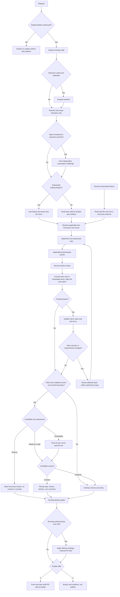

# ODD and RDD — user guide

How to use Organic Driven Development and Receipt-Driven Development from Claude Code, Cursor, or Agent Hub. This is
the single guide for both; the skills' READMEs point here.

## Organic Driven Development (ODD)

ODD keeps the ordinary explore → implement → proportionate checks flow. For substantial, authorized implementation the
agent creates one feature document after exploration — you do not ask for task tracking or choose storage. Small,
understood work creates no durable artifact. Explanation, investigation, and proposal-only requests stay read-only.

### The protocol

- **Authorize** — establish whether the request authorizes a change; read-only work stays read-only.
- **Explore** — the existing code and requirements first, proportionately to the request.
- **Resolve uncertainty** — optional research for a named uncertainty, one focused question for a real product
  decision, at most one assumption challenge for a high-consequence unproven premise.
- **Classify** — small when understood, risk contained, and resumable from the request plus `git diff`; large only
  when that resume test fails. Counts of files, commands, tests, fixes, or a requested todo list never decide it.
- **Track before the first write** — for large work, create the feature document and its mirror, and say in one line
  which document was created and how many tasks it holds.
- **Implement task by task** — the smallest useful route, test-first by default, checkboxes ticked only with observed
  proof, and work-unit commits in reviewable slices of about 400 authored lines; a high-risk unit gets its own commit.
- **Close** — the verified outcome, every failed or pending check, the Risk line, and the publish offer: `1` pushes
  and opens the draft pull request (chained drafts when the work is over 400 lines), `2` leaves publishing to you.
  Marking ready and merge are always yours.
- **Language** — the agent talks to you in your language; commits, pull requests, and the feature document follow the
  repository's language (English unless `AGENTS.md` says otherwise); your quoted words stay verbatim.

### The feature document

`<DOCS_ROOT>/odd/tasks/<feature-name>.md`, in a fixed order: a two- or three-line header (objective, branch, delivery
strategy, test runner); `## Specs` with numbered `S#` that quote your exact strings, errors, and examples verbatim, with
acceptance criteria and checks; `## Tasks` with one line per task (id, linked `S#`, route, commit); `## Log` last, where
`L1` is your original request verbatim. A requirement change rewrites only the affected spec and reopens only its task.
`tools/odd_tasks` creates and validates it and keeps a mirror under the git common directory for resume.

## Receipt-Driven Development (RDD)

RDD records bounded, independent review evidence for one frozen candidate — normally a work-unit commit against the
last reviewed boundary. It is **on by default and yours to switch off**; it never gates a commit, push, or pull request.

- **Tier from evidence, never size.** `passive` (every path proven passive prose) stays silent with structural checks;
  `medium` and `high` ask your consent first.
- **0 / 1 / 4 lenses.** Medium runs the one focus that fits; high runs all four — Risk, Readability, Reliability,
  Resilience — each a read-only reviewer.
- **Refute before fixing.** Only BLOCKER and CRITICAL findings are verified: one general refuter, or three with a
  two-of-three vote on a full review.
- **One correction.** Half the candidate's lines, at most 200; over budget or failed validation goes to you.
- **When review is due:** high risk at its own commit; medium once the open slice reaches 400 lines; passive never.

## The flow



## The skills and tools

| Skill | Use it to |
| --- | --- |
| [odd](../odd/SKILL.md) | Run the protocol on a request, step by step; resume a feature |
| [odd-run](../odd-run/SKILL.md) | Run the whole flow in one invocation, stopping only at your gates |
| [work-unit-commits](../work-unit-commits/SKILL.md) | Make each commit one reviewable unit with its tests, docs, and rollback boundary |
| [chained-pr](../chained-pr/SKILL.md) | Split work over 400 lines into chained pull requests |
| [rdd](../rdd/SKILL.md) | Run, inspect, or resume a receipt review; switch RDD on or off |
| [rdd-run](../rdd-run/SKILL.md) | Run one complete receipt review of the current candidate |
| [odd-rdd-help](./SKILL.md) | This guide, the chooser, and "where am I?" — read-only |

| Tool | Owns |
| --- | --- |
| [tools/odd_tasks](../../../tools/odd_tasks/README.md) | Creating and validating the feature document, the mirror, the 400-line budget |
| [tools/rdd_receipts](../../../tools/rdd_receipts/README.md) | Tiers, `review_due`, boundaries, lenses, the ledger, refuter votes, the correction budget, the switch |

## Which skill

| You want to… | Paste |
| --- | --- |
| Go from a request to a delivered change in one command | `/odd-run <request>` |
| Work a request step by step | `/odd <request>` |
| Continue an interrupted feature | `/odd-run continue <feature-name>` |
| Review the last commit with receipts | `/rdd-run` |
| See where a review stands | `Use rdd and show me the status and next step` |
| Stop using RDD | `Use rdd to disable it` |
| Split a large branch into pull requests | `/chained-pr` |
| Know what to do next | `/odd-rdd-help where am I?` |

## Setting up each runtime

All runtimes read the same `SKILL.md` files.

| Runtime | Discovers skills in | Setup | Invoke |
| --- | --- | --- | --- |
| Cursor | `.agents/skills/` | None | `/odd-run` from the Agent slash menu, or "Use odd-run: …" |
| Claude Code | `.claude/skills/` | Once, from the repository root: `mkdir -p .claude && ln -s ../.agents/skills .claude/skills` | `/odd-run <request>`, or "Use odd-run: …" |
| Agent Hub | `.agents/skills/` | `node tooling/agent-hub/server.mjs` | **ODD Navigator** or **Receipt Reviewer**, or `/odd-run` in any chat |

Both tools need only `python3` and `git`.

## Examples

```text
/odd-run The "Contributing" link in README.md points to a file that no longer exists. Fix it.
```

Small path: inline fix, structural check, `Risk: none`, no feature document. If you ask for a commit and RDD is on, it
assesses `passive` and stays silent.

```text
/odd-run GET /orders returns 500 when limit is negative. It should return 400 with "limit must be positive".
```

Small and understood: RED test, fix, GREEN, suite once. If you ask for a commit, it assesses `medium` and
`under_budget`, so it waits in the slice until the slice reaches 400 lines or you ask for a review.

```text
/odd-run Add SSO login to the admin panel with our identity provider; keep the password login for break-glass accounts.
```

Large: one question if a product decision is open, then `docs/odd/tasks/admin-sso.md` with your sentence quoted in
`S#`, tasks committed one unit at a time, the auth commit alone and reviewed `high` with four lenses after your consent.

```text
/rdd-run
/odd-rdd-help What does "review_due_reason: under_budget" mean?
```

## Reading the output

**Risk line.** `Risk: item N (reason)` names a high-risk item — 1 data, 2 security, 3 contracts others consume, 4
concurrency, 5 delivery or environment, 6 no test would catch a regression — and triggers an independent verifier.
`Risk: none` means the diff touches none, shared helpers included.

**`odd_tasks.py check`.** Each finding prints `path:line: message` — a header key missing, sections out of order, a
spec gap, a task linked to a missing spec, a spec with no task, a checked task without evidence, or a log without a
verbatim `L1`.

**`review_due_reason`.** `high_risk` and `slice_budget_reached` mean review now; `under_budget` waits in the slice;
`passive` advances the boundary; `already_reviewed` is covered.

**RDD refusals** print `code`, `cause`, and `next_action`; follow `next_action`. The common ones:
`consent_required`, `lens_required`, `stale_target_identity` (something wrote to the worktree after the freeze),
`already_reviewed`, `mode_off`, `malformed_ledger`, `no_correction`, `export_inside_candidate`.

## Where things are kept

| Artifact | Path | Committed |
| --- | --- | --- |
| Feature document | `<DOCS_ROOT>/odd/tasks/<feature-name>.md` | Yes, with the feature |
| Feature mirror | Git common directory, `odd/<feature-name>/tasks.md` | No |
| RDD review state and boundaries | Git common directory, `rdd/` | No |
| Exported receipts | `<DOCS_ROOT>/execution/rdd/`, or outside the repository | No |
| Risk tuning | `.rdd/risk.json` | Yes, when a repository tunes it |
| RDD switch | Git config `rdd.mode`, per clone or global | No |
