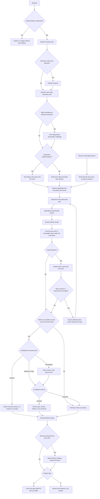

# ODD Run — one full pass

## Mission

Carry one request through the whole flow in one invocation, following [odd](../odd/SKILL.md) exactly. This skill adds
no rule; it removes the pauses between steps and names where the pass must stop.

## The pass



Before each phase, print one line naming it — authorizing, exploring, researching, deciding, implementing, checking,
reviewing, closing — and only when the phase actually changes.

## Gates — where the pass stops

- **Authorize** — ambiguous change intent: one clarification, then wait.
- **Ask trigger** — a real product or design decision: one focused question, then wait.
- **RDD consent** — a medium or high candidate: the consent question, then wait.
- **Chain strategy** — `ask-on-risk` and the budget is exceeded with no cached chain strategy: ask once, then wait.
- **Needs your decision** — partial, blocked, unavailable, or exhausted proof, or an escalated review.
- **Publish** — the close offer: `1` pushes and opens the draft pull request or chained drafts, `2` ends with the branch
  and its evidence. Marking ready and merge always stay the user's.

A pass MUST NOT skip a gate to finish faster, and MUST NOT end with a tracked task pending unless it quotes the user's
explicit stop.

## Resuming

"Continue" resumes from durable state, never from memory: the feature document and its mirror —
`odd_tasks.py status` and `mirror check` — then `git log` and `rdd.py status --next`. Reconcile, name the phase being
resumed, and carry on from the gate that stopped the pass.

## Final report

```text
ODD — <feature or request>
Size: <small | large> · Route: <inline | delegated per task>
Outcome: <verified result>
Tasks: <done>/<total> · Document: <DOCS_ROOT>/odd/tasks/<feature>.md · Mirror: <written | pending>
Checks: <command → result>, … · Not run: <…>
RDD per commit: <sha — tier, outcome>, … | disabled/unmanaged
Delivery: <strategy> · <lines>/400 · slices: <…> · PR: <draft links | not published>
Risk: <item N (reason) | none>
Next: <the user's decision, or none>
```
